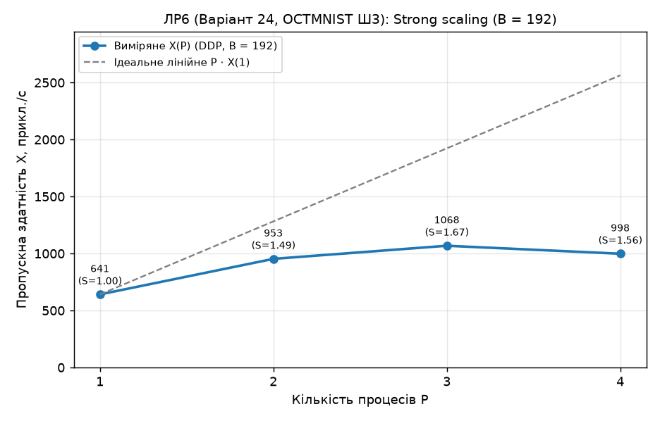
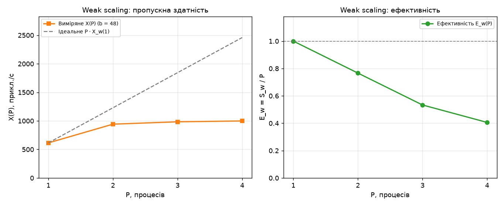
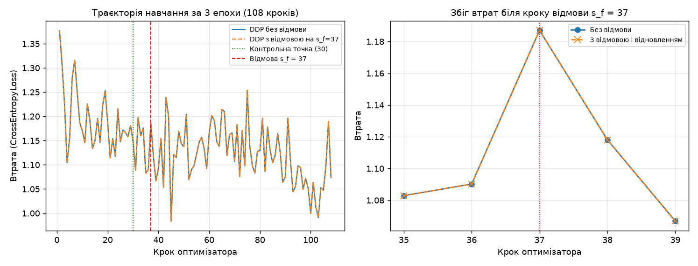

# Лабораторна робота №6
## Розподілене навчання нейромережі за даними на CPU (Варіант 24)

**Дисципліна:** «Високопродуктивні розподілені обчислювальні системи»  
**Мета роботи:** реалізувати розподілене синхронне навчання згорткової нейромережі (`Data Parallelism`, SGD з усередненням градієнтів через `all-reduce` на бекенді `gloo`) в $P$ паралельних процесах на CPU; перевірити еквівалентність паралельного й однопроцесного градієнтного кроку; порівняти ручну синхронізацію градієнтів і `DistributedDataParallel` (`DDP`); оцінити масштабованість у режимах *strong scaling* і *weak scaling*; дослідити вплив глобального розміру батча та лінійного масштабування швидкості навчання на якість класифікації; перевірити відмовостійкість через періодичні контрольні точки та автоматичний перезапуск групи `torchrun`.

---

## 1. Варіант 24, стенд та особливості середовища виконання

За таблицею варіантів для № 24 задано:

- **Датасет:** **Д6 — OCTMNIST** (оптична когерентна томографія сітківки, 4 класи `K = 4`, 1 канал `C = 1`, зображення $28 \times 28$; навчальна підвибірка — перші `N = 7000` прикладів `train`, тестова — усі `1000` прикладів `test`, нормалізація $x' = (x / 255 - 0{,}5) / 0{,}5$).
- **Ширина мережі:** **Ш3** — `c1 = 64`, `c2 = 128`, `h = 512`.
- **Кількість параметрів моделі:**
  $$n_{\text{params}} = 9 \cdot 1 \cdot 64 + 64 + 9 \cdot 64 \cdot 128 + 128 + 49 \cdot 128 \cdot 512 + 512 + 512 \cdot 4 + 4 = 3\,288\,324$$
  За розміру `float32` 4 байти загальний обсяг градієнтів становить $M = 4 \cdot 3\,288\,324 = 13\,153\,296\text{ байт} \approx 12{,}54\text{ МіБ}$.
- **Параметри розподіленого навчання:** $P_{\max} = 4$, глобальний батч $B = 192$, локальний батч процесу $b = B / P_{\max} = 48$, кількість потоків на процес $n_{\text{th}} = \lfloor C_{\text{phys}} / P_{\max} \rfloor = \lfloor 8 / 4 \rfloor = 2$, оптимізатор `SGD(lr = 0.02, momentum = 0.9)`, $n_{\text{ep}} = 3$ епохи, інтервал контрольних точок $K_c = 15$ кроків, крок імітації відмови $s_f = 37$.

### Примітка щодо середовища запуску (Linux Docker поверх Windows 11 / WSL2)

Нативна Windows-збірка `torch 2.15.0+cpu` під час запуску `torchrun --rdzv-backend=static` аварійно завершується в `TCPStore` з помилкою `use_libuv was requested but PyTorch was built without libuv support`, а також конфліктує з системним відображенням `127.0.0.1` на `kubernetes.docker.internal` (`system error 10049`). Щоб забезпечити стабільний штатний транспорт `gloo` через інтерфейс зворотного зв’язку `lo`, усі обчислювальні експерименти проведено в ізольованому Linux-контейнері Docker (`python:3.12-slim` + `torch 2.15.0+cpu`, середовище [`Dockerfile`](Dockerfile)) поверх ядра WSL2 на хост-машині. У змінних середовища зафіксовано `GLOO_SOCKET_IFNAME=lo`, `OMP_NUM_THREADS=2`, `MKL_NUM_THREADS=2`, `OPENBLAS_NUM_THREADS=2`.

Окрім цього, у `torch 2.15.0` виявлено особливість `StaticTCPRendezvous`: при `--max-restarts=1` агент `torchrun` утримує єдиний екземпляр `TCPStore` на порту `29500` між спробами перезапуску, не додаючи номер спроби до префікса ключів `default_pg`, через що при рестарті процеси намагаються під’єднатися до старих ефемерних портів `gloo` померлих процесів (`Connection refused`). У [`train_ddp.py`](train_ddp.py) це усунуто штатним обгортанням `TCPStore` у `PrefixStore(f"restart_{restart_cnt}/default_pg", base_store)` при `TORCHELASTIC_RESTART_COUNT > 0`.

### Таблиця 1. Стенд та параметри моделі

| Процесор | Фізичних ядер $C_{\text{phys}}$ | Логічних ядер | Пам’ять хоста, ГБ (контейнера, ГБ) | ОС | Python | PyTorch | $n_{\text{th}}$ |
|---|---:|---:|---:|---|---|---|---:|
| 12th Gen Intel(R) Core(TM) i5-12450H | 8 | 12 | 15.71 (7.61) | Linux 6.18.58.1-WSL2 (Docker / Windows 11) | 3.12.16 | 2.15.0+cpu | 2 |

| Датасет | $K$ | $C$ | $c_1 / c_2 / h$ | $n_{\text{params}}$ | $M$, МіБ | $N$ | $B$ | $P_{\max}$ |
|---|---:|---:|---|---:|---:|---:|---:|---:|
| Д6 (`octmnist`) | 4 | 1 | 64 / 128 / 512 | 3 288 324 | 12.54 | 7000 | 192 | 4 |

---

## 2. Еквівалентність градієнтів, ручна синхронізація та DDP

Перевірку коректності та порівняння режимів на $P_{\max} = 4$ виконано в кроці 2 ([`results/step2_equiv.json`](results/step2_equiv.json), [`results/step2_manual_bench.json`](results/step2_manual_bench.json), [`results/step3_strong_p4.json`](results/step3_strong_p4.json), [`results/step3_strong_nosync_p4.json`](results/step3_strong_nosync_p4.json)). Бенчмарки швидкості (`10` кроків прогріву, далі `50` вимірюваних кроків) на $P = 4, b = 48$ єдині для таблиць 2, 3 і 4.

### Таблиця 2. Синхронізація градієнтів

| Режим | $t_{\text{step}}$, мс | Час обміну на крок, мс | Частка кроку в обміні | $X$, прикл./с |
|---|---:|---:|---:|---:|
| 1 процес, батч $B = 192$ | 259.97 | 0 | 0 | 701.16 |
| 4 процеси, ручна синхронізація ($b = 48$) | 216.07 | 71.60 | 0.3314 | 842.11 |
| 4 процеси, DDP ($b = 48$) | 182.10 | 69.83 | 0.3834 | 998.30 |
| 4 процеси, DDP, `no_sync` ($b = 48$) | 112.27 | 0 | 0 | 1608.99 |

| $\max \|g - \bar{g}\| / \max \|g\|$ | Різниця сум ваг між процесами після 50 кроків | `ACC`, 1 процес | `ACC`, DDP на $P_{\max}$ | `AUC`, 1 процес | `AUC`, DDP на $P_{\max}$ |
|---:|---:|---:|---:|---:|---:|
| `5.535e-06` | `0.0` | 0.2790 | 0.2960 | 0.6625 | 0.6858 |

**Аналіз результатів кроку 2:**
1. **Еквівалентність градієнта і ваг.** На першому батчі з 192 прикладів відносна розбіжність між еталонним градієнтом одного процесу $g$ та усередненим градієнтом 4 процесів $\bar{g}$ становить $5{,}535 \cdot 10^{-6}$, що лежить у межах очікуваної похибки неасоціативності додавання чисел `float32` ($10^{-6}$–$10^{-5}$). Після 50 кроків оптимізатора суми всіх ваг у `float64` на усіх чотирьох рангах збігаються точно (`-78.52234790809769` на кожному процесі, різниця `0.0`), оскільки після `all-reduce` кожен процес отримує ідентичний градієнт і застосовує той самий крок `SGD`.
2. **Порівняння ручної синхронізації та DDP.** Ручна синхронізація витрачає `71.60 мс` на 8 послідовних викликів `dist.all_reduce` уже після повного завершення `backward()`, через що сумарний час кроку дорівнює `216.07 мс` ($X = 842{,}11$ прикл./с). Натомість `DDP` групує параметри у кошики (перший кошик до 1 МіБ, наступний — решта тензорів) у зворотному до `forward` порядку та запускає асинхронний `all-reduce` для вихідного повнозв’язного шару ще до завершення `backward()` перших згорткових шарів. Завдяки зменшенню кількості мережевих транзакцій і перекриттю обчислень з обміном `DDP` скорочує неперекритий час обміну до $t_{\text{comm,exp}} = 182{,}10 - 112{,}27 = 69{,}83\text{ мс}$, а медіанний час кроку — до `182.10 мс` ($X = 998{,}30$ прикл./с, на $18{,}5\,\%$ швидше за ручну синхронізацію).
3. **Якість на 1 процесі проти 4 процесів DDP.** Обидва запуски зробили по `108` кроків оптимізатора за 3 епохи ($\lfloor 7000 / 192 \rfloor \cdot 3 = 36 \cdot 3 = 108$). Невелика різниця в метриках (`ACC` `0.2790` проти `0.2960`, `AUC` `0.6625` проти `0.6858`) зумовлена тим, що однопроцесний `DataLoader(shuffle=True)` та `DistributedSampler` на 4 процесах формують різні конкретні перестановки індексів батчів за тих самих розмірів вибірок і гіперпараметрів.

---

## 3. Strong scaling ($B = 192 = \text{const}$)

У серії прогонів кроку 3 глобальний батч зафіксовано на $B = 192$, а локальний батч зменшувався обернено пропорційно кількості процесів: $b = 192, 96, 64, 48$ для $P = 1, 2, 3, 4$ через `torchrun` з обгорткою `DDP`.

### Таблиця 3. Strong scaling, $B = 192\text{ const}$

| $P$ | $b$ | $t_{\text{step}}$, мс | $t_{\text{step,ns}}$, мс | $X$, прикл./с | $S$ | $E$ | $e$ | $c$ |
|---:|---:|---:|---:|---:|---:|---:|---:|---:|
| 1 | 192 | 277.14 | 228.06 | 641.02 | 1.0000 | 1.0000 | − | 0.1771 |
| 2 | 96 | 187.34 | 151.43 | 953.04 | 1.4868 | 0.7434 | 0.3452 | 0.1917 |
| 3 | 64 | 169.70 | 145.00 | 1068.21 | 1.6664 | 0.5555 | 0.4001 | 0.1456 |
| 4 | 48 | 182.10 | 112.27 | 998.30 | 1.5574 | 0.3893 | 0.5228 | 0.3834 |

**Аналіз strong scaling:**
- Під час збільшення кількості процесів з $P = 1$ до $P = 3$ пропускна здатність зростає з `641.02` до `1068.21 прикл./с` ($S(2) = 1{,}49$, $S(3) = 1{,}67$), проте ефективність послідовно знижується ($E(2) = 0{,}74$, $E(3) = 0{,}56$), а на $P = 4$ швидкість опускається до `998.30 прикл./с` ($S(4) = 1{,}56$, $E(4) = 0{,}39$).
- Метрика Карпа–Флатта $e(P)$ не лишається сталою, а зростає з `0.3452` ($P = 2$) до `0.4001` ($P = 3$) і `0.5228` ($P = 4$). Зростання $e(P)$ означає, що деградація прискорення визначається не фіксованою послідовною ділянкою коду, а накладними витратами паралельного виконання — насамперед міжпроцесним обміном `all-reduce` та синхронізаційним очікуванням.
- Це підтверджується безпосередньо часткою обміну $c$: при $P = 4$ величина $t_{\text{comm,exp}}$ підскакує до `69.83 мс`, тобто $c = 38{,}34\,\%$ усього кроку (проти `14.56%` на $P = 3$). Крім зростання обсягу передач у `gloo` через TCP loopback над градієнтами розміром $12{,}54$ МіБ (пов’язаного з масивним повнозв’язним шаром `7*7*128 -> 512`), на процесорі Intel Core i5-12450H діє гібридна архітектура (`4` високопродуктивні P-ядра з Hyper-Threading + `4` енергоефективні E-ядра): при $P = 4, n_{\text{th}} = 2$ навантаження займає всі 8 фізичних ядер включно з повільнішими E-ядрами, і в синхронному SGD усі процеси змушені чекати найповільнішого воркера на бар’єрі `all-reduce`. Зауважимо також, що навіть за $P = 1$ існує різниця між `277.14 мс` та `228.06 мс` (`c = 0.1771`): без `no_sync` reducer `DDP` копіює градієнти в кошики та проходить штатний конвеєр синхронізації, а в `no_sync` ці витрати вимкнені.

---

## 4. Weak scaling ($b = 48 = \text{const}$) і вплив розміру батча на якість

### Таблиця 4. Weak scaling, $b = 48\text{ const}$

| $P$ | $B_P$ | $t_{\text{step}}$, мс | $X$, прикл./с | $S_w$ | $E_w$ |
|---:|---:|---:|---:|---:|---:|
| 1 | 48 | 75.82 | 614.77 | 1.0000 | 1.0000 |
| 2 | 96 | 93.82 | 942.39 | 1.5329 | 0.7665 |
| 3 | 144 | 139.82 | 983.79 | 1.6003 | 0.5334 |
| 4 | 192 | 182.10 | 998.30 | 1.6239 | 0.4060 |

За фіксованого локального навантаження $b = 48$ прикладів на процес час кроку мав би лишатися сталим (~`75.8 мс`) за ідеального масштабування, однак зростає до `182.10 мс` при $P = 4$ (більш ніж у 2,4 раза), через що $S_w(4) = 1{,}62$, а $E_w(4) = 0{,}41$. Оскільки мережа Ш3 містить понад 3,28 млн параметрів, вага обміну через `gloo` (пересилання `12.54 МіБ` на кожен крок на всіх рангах) та конкуренція потоків $P \cdot n_{\text{th}} = 8$ за спільний L3-кеш, шину пам’яті й повільніші E-ядра обмежують сумарну пропускну здатність на CPU рівнем ~`1000 прикл./с` уже з $P = 3$.

### Таблиця 5. Якість за різних глобальних батчів ($n_{\text{ep}} = 3$)

| Режим | $B_P$ | $\eta$ | Кроків оптимізатора за $n_{\text{ep}}$ епох | `ACC` | `AUC` | Найбільша втрата за останню епоху |
|---|---:|---:|---:|---:|---:|---:|
| $P = 1$ | 48 | 0.02 | 435 | 0.4550 | 0.8189 | 1.1791 |
| $P = 4$, з кроку 2 | 192 | 0.02 | 108 | 0.2960 | 0.6858 | 1.2540 |
| $P = 4$ (лінійне масштабування $\eta_P$) | 192 | 0.08 | 108 | 0.4270 | 0.7613 | 1.0935 |

**Аналіз якості:**
- При збільшенні глобального батча в 4 рази ($48 \to 192$) без зміни швидкості навчання ($\eta_0 = 0{,}02$) кількість кроків оптимізатора за 3 епохи падає в 4 рази: з $3 \cdot \lfloor 7000 / 48 \rfloor = 435$ до $3 \cdot \lfloor \lceil 7000 / 4 \rceil / 48 \rfloor = 108$. Через учетверо менше сумарне зміщення ваг модель недонавчається: `ACC` знижується з `0.4550` до `0.2960`, а `AUC` — з `0.8189` до `0.6858`.
- Застосування лінійного правила масштабування $\eta_P = \eta_0 \cdot (B_P / B_0) = 0{,}02 \cdot 4 = 0{,}08$ компенсує зменшення числа кроків без розходження оптимізації (навіть без warmup): максимальна втрата за 3-тю епоху знизилась до `1.0935`, `ACC` зросла з `0.2960` до `0.4270` (+13,1 в. п.), а `AUC` — з `0.6858` до `0.7613`. Розрив, що лишився відносно $B = 48$ (`0.4270` проти `0.4550`), пояснюється вищим рівнем стохастичного шуму дрібніших батчів та меншою кількістю послідовних проєкцій кривизни за фіксованого числа епох.

---

## 5. Контрольні точки, відмова процесу та відновлення

У кроці 5 до навчання `DDP` на $P_{\max} = 4$ ($B = 192, \eta = 0{,}02$) додано збереження стану моделі, оптимізатора та позиції ітератора (`epoch`, `step_in_epoch`, `step`) на ранзі 0 кожні $K_c = 15$ кроків через тимчасовий файл і атомарне `os.replace`. На початку кроку $s_f = 37$ процес із `rank = P_max - 1 = 3` створював файл-позначку (`t_f`) і завершувався викликом `os._exit(1)`. `torchrun` з параметрами `--max-restarts=1 --rdzv-backend=static --master-addr=127.0.0.1 --master-port=29500 --node-rank=0` припинив решту рангів сигналом `SIGTERM` і перезапустив усю групу з контрольної точки.

### Таблиця 6. Відмова і відновлення

| $K_c$ | $s_f$ | Крок останньої контрольної точки | Кроків виконано повторно | $t_{\text{lost}}$, с |
|---:|---:|---:|---:|---:|
| 15 | 37 | 30 | 6 | 8.55 ($t_r = 7{,}52\text{ с}$) |

| Крок | 35 | 36 | 37 | 38 | 39 | `ACC` після 3 епох |
|---|---:|---:|---:|---:|---:|---:|
| Втрата, прогін з відмовою | 1.0829 | 1.0902 | 1.1870 | 1.1180 | 1.0669 | 0.2960 |
| Втрата, прогін без відмови | 1.0829 | 1.0902 | 1.1870 | 1.1180 | 1.0669 | 0.2960 |

**Аналіз відмовостійкості:**
- Остання контрольна точка перед кроком відмови $s_f = 37$ була збережена на кроці `30` ($30 < 37 < 45$), тому після відмови на старті 37-го кроку довелося повторно виконати $(37 - 1) - 30 = 6$ кроків (`31..36`), що близьке до теоретичного середнього $K_c / 2 = 7{,}5$ кроків при рівномірній імовірності відмови всередині інтервалу контрольних точок.
- Із журналів часу ([`results/step5_recovery.json`](results/step5_recovery.json), [`results/step5_fail.marker`](results/step5_fail.marker)): момент збереження контрольної точки № 30 $t_c = 1795552328{,}180\text{ с}$, момент відмови $t_f = 1795552329{,}209\text{ с}$ (втрачена робота до відмови $t_f - t_c = 1{,}029\text{ с}$ за 6 кроків), момент завершення першого кроку після перезапуску (кроку `31`) $t_{\text{first}} = 1795552336{,}729\text{ с}$. Таким чином, накладний час зупинки групи, перезапуску 4 процесів, ініціалізації `gloo`, завантаження датасету та файлу контрольної точки становить $t_r = 7{,}520\text{ с}$, а сумарний втрачений через відмову час — $t_{\text{lost}} = 1{,}029 + 7{,}520 = 8{,}549\text{ с}$ (`8.55 с`).
- Завдяки збереженню стану оптимізатора `SGD` (включно з буфером імпульсу `momentum=0.9`), відновленню `sampler.set_epoch(epoch)` та пропуску перших `step_in_epoch = 30` батчів навчання пішло точно тим самим шляхом даних: втрати на всіх п’яти контрольних кроках `35..39` збіглися з прогоном без відмови до шостого знака ($\max |\Delta L| = 0{,}0$), як і підсумкова точність `ACC = 0.2960` (та практично ідентична `AUC`: `0.6861` проти `0.6858`).

---

## 6. Висновки

1. Синхронний паралелізм за даними (`gloo` на CPU) еквівалентний однопроцесному градієнтному кроку з точністю представлення `float32` ($\max |g - \bar{g}| / \max |g| = 5{,}535 \cdot 10^{-6}$ та нульова різниця сум ваг між рангами після 50 кроків).
2. `DDP` випереджає ручну синхронізацію градієнтів на $18{,}5\,\%$ за пропускною здатністю (`998.30` проти `842.11 прикл./с`) завдяки бакетингу тензорів і перекриттю `all-reduce` зі зворотним проходом `backward()`.
3. Для моделі Ш3 ($12{,}54$ МіБ параметрів) масштабування на одному багатоядерному CPU обмежується як витратами міжпроцесного обміну через TCP loopback ($c = 0{,}3834$ при $P = 4$), так і нерівномірністю гібридних P/E-ядер процесора i5-12450H, що зумовлює пік *strong scaling* на $P = 3$ ($S = 1{,}67$) та насичення *weak scaling* на рівні `~1000 прикл./с` ($E_w(4) = 0{,}41$).
4. При збільшенні глобального батча в 4 рази за фіксованого числа епох якість моделі суттєво падає (`ACC`: `0.4550 -> 0.2960`), але лінійне масштабування швидкості навчання ($\eta_4 = 4\eta_0 = 0{,}08$) відновлює її до `ACC = 0.4270` (`AUC = 0.7613`) без втрати стійкості на кроках 3-ї епохи.
5. Атомарне збереження контрольних точок кожні 15 кроків разом із детермінованим відновленням семплера забезпечує точне продовження траєкторії навчання після аварійного збою процесу (`max |\Delta L| = 0` біля $s_f = 37$, `ACC = 0.2960`), обмежуючи витрати відмови 6 повторними кроками та сумарним простоєм $t_{\text{lost}} = 8{,}55\text{ с}$.
